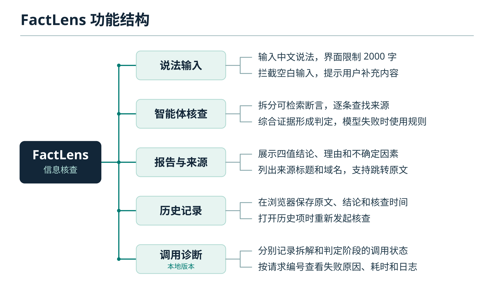
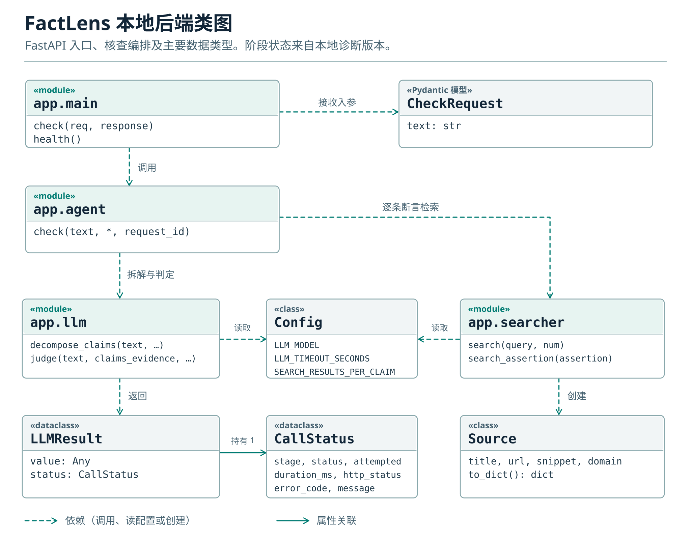

# FactLens 事实透镜 · 需求说明

## 用户、问题与首版范围

家里长辈曾在群里转发一条关于西柚和多种药物相互作用的提醒。家人既想知道这种作用是否存在，也想知道转发消息里提到的数量有什么依据。我们因此把“分别核查一句话里的几项说法”和“打开来源对照原文”列入首版需求。

用户在网页输入一段中文文字，查看整体结论、判断理由和参考来源。一次核查应当交代证据不足的地方。首版只接收文字，核查历史保存在使用者当前浏览器。课程要求同时包括团队展示、选题和需求文档。本说明参考软件需求规格和软件文档编制规范，功能的验收办法另表列出。[课程作业](https://edu.cnblogs.com/campus/gdgy/Class56-Grade2024-CS/homework/16766) · [GB/T 9385—2008](https://openstd.samr.gov.cn/bzgk/gb/newGbInfo?hcno=2790825C43AD0B69E3C38C140BFFCFE6) · [GB/T 8567—2006](https://openstd.samr.gov.cn/bzgk/std/newGbInfo?hcno=84C42B6277D2714B7176B10C6E6B1A44)

## 功能和代码

| 编号 | 用户能做什么 | 实现位置和边界 |
| --- | --- | --- |
| F01 输入 | 输入一段文字，提交并看到等待提示。接口应拒绝空白和超出 2000 字的输入。 | [网页](../src/App.vue)限制输入长度并防止重复提交，[FastAPI](../factlens-backend/app/main.py)独立校验。公网接口须单独验收。 |
| F02 断言拆解 | 提交含多项事实的消息，系统先区分其中可以分别查证的说法。 | [智能体编排](../factlens-backend/app/agent.py)调用模型拆解最多三项断言。模型拆解不可用时按句切分。 |
| F03 证据检索 | 每项断言有一组检索结果，保留标题、链接、摘要和域名。 | [检索模块](../factlens-backend/app/searcher.py)逐项查找。仓库代码检索必应，线上样例返回中文维基百科词条。 |
| F04 综合判定 | 阅读“确认属实”“确认不实”“部分属实”或“暂无法核实”，并看到理由与不确定因素。 | [模型调用](../factlens-backend/app/llm.py)使用原文和检索材料作整体判定。调用不可用时，编排层使用规则生成报告。词频和域名只能提供参考，不能保证判定准确。 |
| F05 报告展示与复制 | 查看和复制包含摘要、理由、支持、反驳与不确定因素的报告。 | [网页](../src/App.vue)渲染这些字段。每份报告应始终对应本次提交的原文。 |
| F06 来源复核 | 点击来源标题，打开原网页核对上下文。 | 后端按 URL 去重。前端展示汇总后的标题和域名，尚待增加按单条断言展示摘要的功能。 |
| F07 历史记录 | 刷新后仍能查找、删除记录或用原文重新核查。 | [网页](../src/App.vue)用浏览器本地存储保存输入、结论和时间。点开记录会发出新请求，旧报告不会完整归档。 |
| F08 时间与调用状态 | 查看报告的核查时间和实际判定方式。 | 后端按北京时间标记报告。本地开发中的诊断版通过 `llm.stages.decompose` 和 `llm.stages.judge` 显示拆解、判定的执行结果，通过 `request_id` 关联后端日志。公网旧字段不足以证明本次模型调用成功。 |

## 运行环境与接口

公网前端托管于 Cloudflare Pages，调用 PythonAnywhere 上的后端。前端所用服务地址由 `VITE_API_BASE` 指定。团队部署资料记录了线上的 WSGI 入口，这份入口文件尚未归入当前仓库。本地使用 Vue 3/Vite 和 Python/FastAPI，模型凭证只在服务端配置。[本地启动](../README.md) · [公网首页](https://factlens-dn7.pages.dev/) · [公网健康接口](https://factlens.pythonanywhere.com/api/health)

| 接口 | 输入 | 预期输出 |
| --- | --- | --- |
| `POST /api/check` | JSON 对象，例如 `{"text":"地球是太阳系的一颗行星。"}` | 成功时返回结论、摘要、理由、支持和反驳信息、不确定因素、断言及来源、核查时间。非法长度和空白输入应在调用模型前被拒绝。 |
| `GET /api/health` | 无 | 返回服务和配置状态。本接口不执行一次真实核查。 |

图中的 `CheckRequest` 和 `Source` 是数据类型，`app.main`、`app.agent`、`app.llm` 和 `app.searcher` 是模块。本地诊断版还用 `LLMResult` 与 `CallStatus` 保存模型输出和对应调用状态。

## 迭代记录

| 时间（2026 年） | 变更及证据 |
| --- | --- |
| 10 月 30 日 | 建立 Vue 前端，加入核查等待状态。[前端提交](https://github.com/yyue62353-lab/FactLens/commit/3d150f3) |
| 11 月 2 日 | 接入后端智能体，前端开始发送实际核查请求。[前后端联通提交](https://github.com/yyue62353-lab/FactLens/commit/537c67a) |
| 11 月 4 日 | 显式调用提交函数，避免点击事件被误作历史记录标志。[修复提交](https://github.com/yyue62353-lab/FactLens/commit/18d1ba7) |
| 11 月 5 日 | 在公网验证合法、空白和超长输入。本地诊断改动记录两个模型阶段、失败原因和请求编号。 |
| 11 月 7 日 | 验证报告、来源与历史记录，记录混合句总标签和来源相关性问题。[验收记录](acceptance.md) |

## 团队分工（七人、三组）

| 组别 | 人数 | 负责的工作 |
| --- | --- | --- |
| 产品设计与需求分析 | 1 | 从真实使用场景和用户反馈中确定选题、功能范围和验收标准。 |
| 智能体与后端 | 3 | 实现断言拆解、来源检索和判定，维护核查接口、部署和调用日志。 |
| 前端开发与测试 | 3 | 实现输入、报告、来源和历史记录的页面交互，测试核查流程与输入边界，记录缺陷和复测结果。 |
